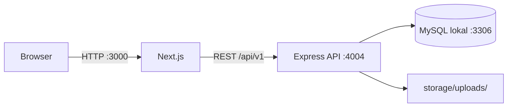

# NutriLife

NutriLife adalah aplikasi web pencatatan kesehatan personal berbahasa Indonesia. Pengguna dapat memantau asupan nutrisi, air minum, langkah, aktivitas, berat badan, dan target harian dalam satu dashboard. Aplikasi juga menyediakan katalog resep dan makanan, artikel kesehatan, serta panel pengelolaan konten dan akun staf.

> Status: aktif dikembangkan. Implementasi saat ini ditujukan untuk pengembangan dan pengujian lokal.

## Fitur utama

### Pengguna

- Registrasi, login, logout, dan reset password.
- Dashboard ringkasan kalori, makronutrien, air, langkah, dan berat badan.
- Tambah, ubah, dan hapus catatan makanan harian.
- Pencarian resep dan data nutrisi untuk mengisi detail makanan secara otomatis.
- Pencatatan air minum, aktivitas, langkah, durasi, kalori terbakar, dan berat badan.
- Pengaturan target kalori, air, langkah, berat, protein, karbohidrat, dan lemak.
- Pengelolaan profil, foto profil, dan password.
- Rencana makan harian, tema gelap, halaman bantuan, serta artikel dan berita kesehatan.

### Nutritionist dan Admin

- Membuat, mengubah, dan menghapus artikel, berita, serta pengumuman.
- Mengunggah gambar artikel/pengumuman dengan batas 5 MB.
- Admin dapat membuat dan mengelola akun `ADMIN` dan `NUTRITIONIST`.
- Perlindungan agar Admin tidak menghapus diri sendiri atau menghapus/menurunkan role Admin terakhir.

## Teknologi

| Lapisan | Teknologi |
| --- | --- |
| Frontend | Next.js 16, React 19, TypeScript, Tailwind CSS 4 |
| Backend | Express 5, TypeScript, Zod |
| Database | MySQL 8 |
| Autentikasi | JWT HS256 (7 hari), password hash `scrypt` |
| Infrastruktur lokal | Docker Compose (opsional), npm, `tsx` |
| Analitik | Vercel Analytics pada production |

## Arsitektur



Frontend dan backend dijalankan sebagai proses terpisah. Backend terhubung langsung ke MySQL lokal yang dikelola melalui phpMyAdmin pada `127.0.0.1:3306`.

## Prasyarat

- Node.js 20 atau lebih baru
- npm
- Salah satu opsi database:
  - MySQL 8 lokal; atau
  - Docker dan Docker Compose

## Menjalankan secara lokal

1. Instal dependensi dan buat konfigurasi environment.

   ```bash
   npm install
   cp .env.example .env
   ```

2. Siapkan database MySQL lokal melalui phpMyAdmin.

   ```bash
   npm run db:setup-local
   ```

   Perintah ini meminta password Admin MySQL, lalu membuat database, user aplikasi, tabel, dan data awal pada `127.0.0.1:3306`.

3. Pastikan database dapat diakses.

   ```bash
   npm run db:check
   ```

4. Jalankan frontend dan backend.

   ```bash
   npm run dev:all
   ```

5. Buka:

   - Aplikasi: [http://localhost:3000](http://localhost:3000)
   - API health check: [http://localhost:4004/health](http://localhost:4004/health)

Registrasi melalui aplikasi selalu menghasilkan akun dengan role `USER`.

## Konfigurasi environment

Gunakan `.env.example` sebagai sumber konfigurasi. Jangan commit file `.env` atau secret production.

| Variabel | Kegunaan | Nilai bawaan/contoh |
| --- | --- | --- |
| `DB_HOST`, `DB_PORT` | Host dan port MySQL utama | `127.0.0.1`, `3306` |
| `DB_USER`, `DB_PASSWORD`, `DB_NAME` | Kredensial database utama | `nutrilife` |
| `DATABASE_URL` | URL koneksi untuk integrasi tambahan | URL MySQL lokal |
| `PORT` | Port backend | `4004` |
| `SERVER_URL` | Base URL backend dan URL file upload | `http://localhost:4004` |
| `FRONTEND_URL` | Origin yang diizinkan oleh CORS | `http://localhost:3000` |
| `NEXT_PUBLIC_API_URL` | Base URL API yang dipakai browser | `http://localhost:4004/api/v1` |
| `JWT_SECRET` | Secret penandatanganan token | wajib diganti di production |
| `UPLOAD_DIR` | Direktori penyimpanan upload | `storage/uploads` |
| `RECIPE_CSV_PATH` | Lokasi default dataset resep | opsional |
| `FASTFOOD_CSV_PATH` | Lokasi default dataset nutrisi | opsional |

`EMAIL_HOST` tersedia sebagai placeholder konfigurasi, tetapi pengiriman email reset password belum diimplementasikan. Pada mode development, token reset dikembalikan langsung oleh API. Pada production, token tidak dikirim ke browser dan perlu dihubungkan ke layanan email sebelum fitur digunakan.

## Role dan akses

| Kapabilitas | USER | NUTRITIONIST | ADMIN |
| --- | :---: | :---: | :---: |
| Mengelola data kesehatan sendiri | Ya | Ya | Ya |
| Membaca artikel publik | Ya | Ya | Ya |
| Mengelola artikel dan pengumuman | Tidak | Ya | Ya |
| Mengelola akun staf | Tidak | Tidak | Ya |

Untuk membuat Admin pertama di lingkungan lokal, daftarkan akun biasa kemudian promosikan melalui MySQL:

```sql
UPDATE `User` SET `role` = 'ADMIN' WHERE `email` = 'admin@nutrilife.com';
```

Login ulang setelah perubahan role.

## Dataset resep dan nutrisi

Impor resep Indonesia:

```bash
npm run db:import-recipes -- /lokasi/Indonesian_Food_Recipes.csv
```

Validasi tanpa menulis ke database:

```bash
npm run db:import-recipes -- /lokasi/Indonesian_Food_Recipes.csv --dry-run
```

Impor dataset nutrisi fast-food:

```bash
npm run db:import-fastfood -- /lokasi/fastfood.csv
```

Importer resep melakukan upsert berdasarkan URL sumber. Importer nutrisi melakukan upsert berdasarkan kombinasi brand dan nama item. Detail format kolom tersedia di [database/README.md](database/README.md).

## Perintah npm

| Perintah | Fungsi |
| --- | --- |
| `npm run dev` | Menjalankan frontend Next.js |
| `npm run dev:backend` | Menjalankan backend dengan watch mode |
| `npm run dev:all` | Menjalankan frontend dan backend bersamaan |
| `npm run db:up` | Menjalankan MySQL Docker |
| `npm run db:setup-local` | Menyiapkan database MySQL lokal |
| `npm run db:check` | Memeriksa koneksi MySQL lokal |
| `npm run db:migrate` | Menjalankan migrasi pada MySQL Docker |
| `npm run db:import-recipes` | Mengimpor dataset resep |
| `npm run db:import-fastfood` | Mengimpor dataset nutrisi |
| `npm run build` | Membuat build production seluruh workspace |
| `npm run build:web` | Membuat build production frontend |
| `npm run build:api` | Mengompilasi backend ke `apps/api/dist` |
| `npm start` | Menjalankan build frontend production |

## Struktur proyek

```text
apps/
├── web/               Aplikasi Next.js, komponen, dan aset statis
└── api/               Express API dan importer data
database/
├── migrations/        Migrasi untuk database yang sudah ada
└── schema/            Skema lengkap dan setup MySQL lokal
storage/uploads/       File unggahan lokal saat runtime
scripts/               Utilitas global setup dan pengecekan database
docs/                  Dokumentasi produk
```

## Endpoint utama

Endpoint publik:

- `GET /health`
- `GET /api/v1/articles`
- `GET /api/v1/articles/:slug`
- `POST /api/v1/auth/register`
- `POST /api/v1/auth/login`
- `POST /api/v1/auth/forgot-password`
- `POST /api/v1/auth/reset-password`

Endpoint lain di bawah `/api/v1` membutuhkan header berikut:

```http
Authorization: Bearer <token>
```

Kelompok endpoint terautentikasi mencakup profil, dashboard, goals, meals, water, activities, weights, recipes, nutrition items, articles, notifications, uploads, dan administrasi staf.

## Build production

```bash
npm run build
npm run build:api
```

Jalankan frontend dengan `npm start` dan backend hasil kompilasi dengan:

```bash
node apps/api/dist/server.js
```

Untuk production, gunakan `JWT_SECRET` acak yang kuat, origin HTTPS yang benar, database terkelola, penyimpanan file persisten, dan layanan pengiriman email. Folder `storage/uploads/` lokal tidak cocok untuk deployment stateless atau multi-instance.

## Dokumentasi produk

Kebutuhan produk, persona, ruang lingkup, acceptance criteria, metrik, dan roadmap tersedia di [docs/PRD.md](docs/PRD.md).
